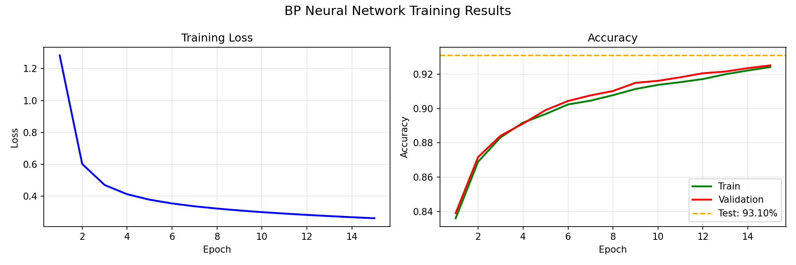
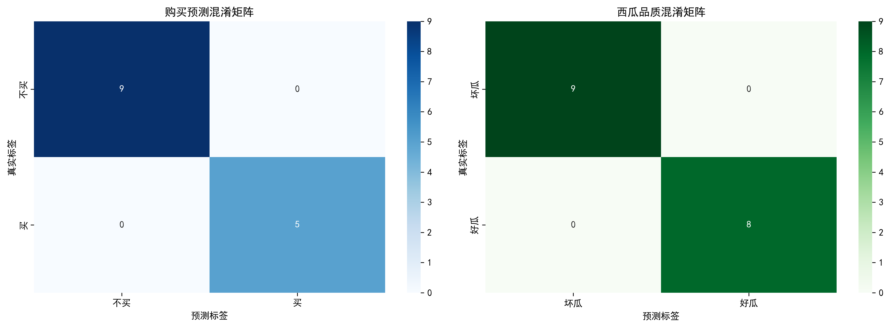
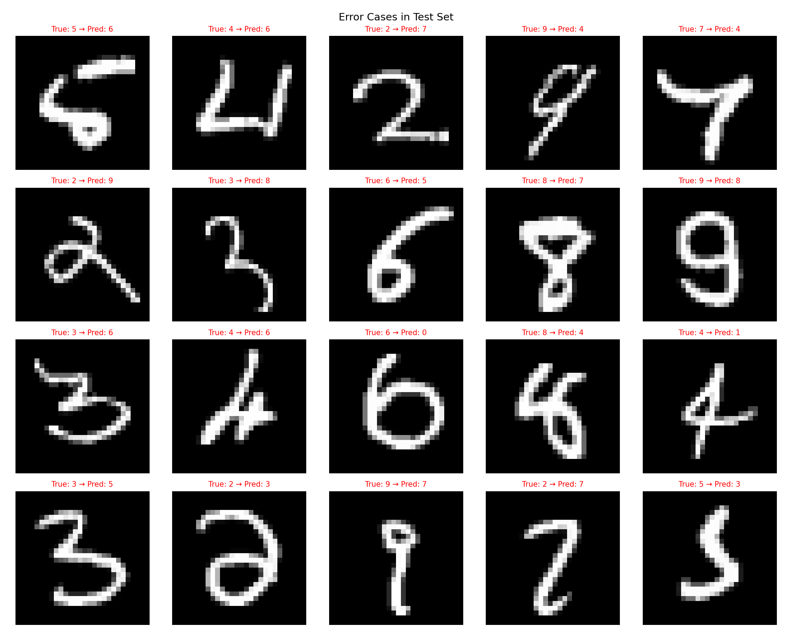

# BP 神经网络手写数字识别（纯 NumPy 实现）

> 不依赖 PyTorch / TensorFlow，用 NumPy 从零实现 BP 神经网络（784-256-10），在 MNIST 上训练与测试，并支持识别自己手写的数字图片。
> 本项目为《人工智能》课程实验 06 作品。

## 亮点

- **零框架依赖**：前向传播、反向传播、He 初始化、Adam 优化器全部手写实现（`digit/network.py`，约 2.8 KB）
- **MNIST 测试集准确率 93.10%**（15 轮训练，纯 NumPy 实现）
- **支持真实手写图片**：拍/画一张数字图放入 `test_images/`，自动二值化、居中、缩放为 28×28 后识别

## 结果

| 训练过程 | 混淆矩阵 |
|---|---|
|  |  |

| 错误案例 |
|---|
|  |

## 网络结构

```
输入层 784 (28×28 像素)
   │  He 初始化权重 + ReLU 激活
隐藏层 256
   │  Softmax
输出层 10 (0–9)
```

- 损失函数：交叉熵
- 优化器：Adam（学习率 0.01）
- 权重初始化：He 初始化（`sqrt(2 / fan_in)`）

## 目录结构

```
bp-digit-recognition/
├── digit/
│   ├── __init__.py
│   ├── network.py          # BP 神经网络核心实现（前向/反向/Adam/保存加载）
│   ├── train.py            # 训练脚本，输出训练曲线
│   ├── test.py             # MNIST 测试集评估，输出混淆矩阵
│   ├── utils.py            # MNIST 数据加载与预处理
│   ├── analysis_image.py   # 生成单个数字的可视化分析图
│   └── num3.npy            # 示例样本数组
├── models/
│   └── bp_model.npz        # 已训练好的权重（可直接测试）
├── test_images/            # 自制手写数字 0–9
├── docs/images/            # 训练与测试产出图
├── data/                   # MNIST 数据占位（不含原始数据）
├── run.py                  # 交互式菜单，一键跑训练/测试/自制图
├── custom_test.py          # 识别 test_images 中的自制图片
├── requirements.txt
└── README.md
```

## 运行方式

**1. 安装依赖**

```bash
pip install -r requirements.txt
```

**2. 下载 MNIST**

把 4 个文件放入 `data/mnist/`（见 [data/README.md](data/README.md)）：

```
train-images-idx3-ubyte
train-labels-idx1-ubyte
t10k-images-idx3-ubyte
t10k-labels-idx1-ubyte
```

下载地址：http://yann.lecun.com/exdb/mnist/

**3. 运行**

```bash
# 交互式菜单（推荐）
python run.py

# 或直接跑某一步
python -m digit.train        # 训练（约 1–2 分钟）
python -m digit.test         # 测试并输出混淆矩阵
python custom_test.py        # 识别 test_images/ 里的自制图片
```

`models/bp_model.npz` 已附带，跳过训练也能直接跑测试。

## 实测结果与局限

- **MNIST 测试集：93.10%**（`models/` 中现成模型）。
- **自制图片：10 张中识别正确 6 张**（本机实测）。原因是自制图片的笔画粗细、留白、对比度与 MNIST 的 28×28 灰度风格差异较大，预处理虽然做了居中与缩放，但无法完全对齐。
- 隐藏层只有 256 个神经元、15 轮训练，属于课程实验规模；加大层宽或轮数、或用数据增强可以明显提升自制图片的鲁棒性。
- `analysis_image.py` 是生成教学分析图的辅助脚本，与主流程无关。

## 环境

Python 3.9+，依赖：numpy / matplotlib / Pillow（`requirements.txt`）。
